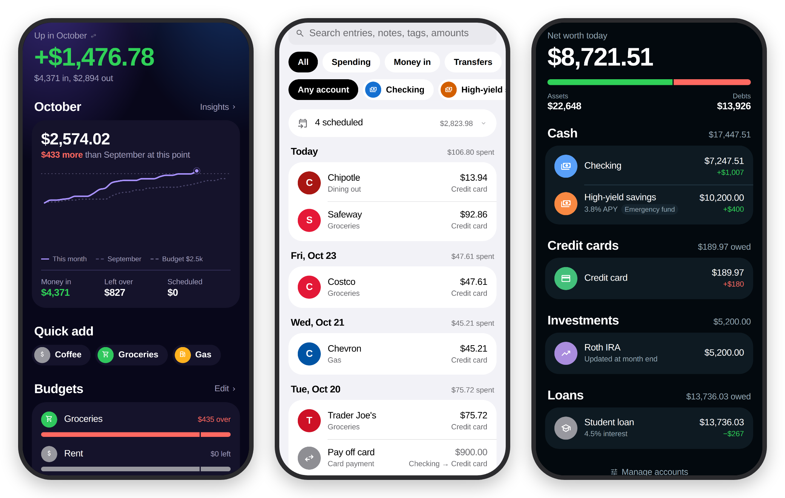
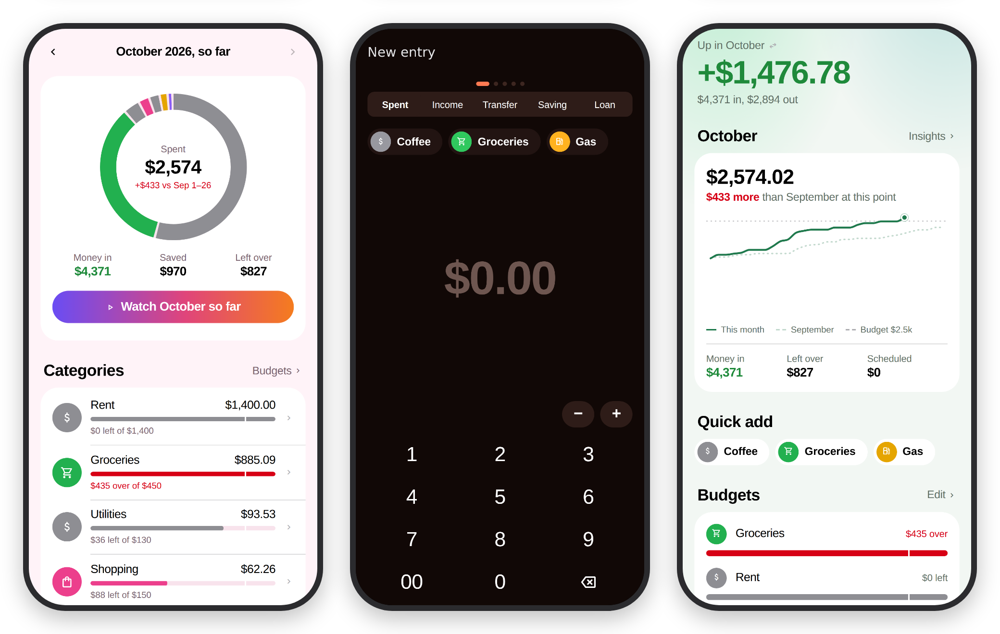

<h1 align="center">Tally</h1>

<p align="center">A personal finance app for iPhone, backed by a small self-hosted server.</p>

<p align="center">
  
  
  
</p>

Tally is a ledger: every entry is one row with a date, a name, a category, an amount and a From and/or To account.
Account balances are never stored. They are derived from the entries every time they're read, so there is nothing to
drift out of sync. It replaced a spreadsheet and is in daily use.

The repo has two halves:

- `app/`, the backend: Python 3.13, FastAPI and SQLite. It holds the data and enforces every money rule.
- `ios/`, the iPhone app: Expo (React Native), SDK 57. It stores nothing of its own and talks to the backend over a
  private network (Tailscale).

<p align="center">
  
</p>

## Features

- Home shows the month's net change, spending drawn against last month's pace (drag across the chart to read any
  day), quick actions, budgets, goals, upcoming entries and recent activity.
- Activity lists every entry by day, with search shortcuts (`>50`, `aug`, `#trip`), filters, saved views, a
  long-press menu (edit, duplicate, delete with undo) and multi-select for recategorizing, tagging or deleting.
- Adding an entry uses a large keypad, merchant memory (a known name fills in its category and account), date
  shortcuts, refunds, splits, notes, tags and receipt photos.
- Entries made without a connection wait on the phone and send themselves later, exactly once.
- Entries can start from a link, `tally://new?amount=6.50&what=Starbucks&card=Amex`, so an iOS Shortcuts automation
  can open a prefilled entry after every tap to pay.
- Accounts shows assets against debts, a balance chart per account, and reconciliation against the bank with a
  diagnosis when the numbers don't match. Loans show a payoff date and what extra monthly payments would save.
- Insights has a month-by-month spending donut, budgets, cash flow, net worth, a month-end checklist and CSV export.
- Recurring entries (with suggestions from repeating ones), budgets suggested from past spending, goals, a
  configurable Home layout, and eight color themes in light and dark.

<p align="center">
  
</p>

## How it works

### The ledger

The category type decides which accounts an entry needs, and the API rejects anything that breaks the rule:

| Category type | From | To |
|---|---|---|
| Money in | no | yes |
| Spending | yes | no |
| Transfer | yes | yes |
| Saving, Loan | yes | optional |

Balances are computed in `app/engine.py`, which has no database access and is tested on its own. Money is stored
as integer cents everywhere. Dollars only appear in request bodies and are converted once, on the way in.

When the spreadsheet was retired, `app/importer.py` imported it and checked that every account balance matched to
the cent.

### The app

The app is built with Expo Router, one file per screen. Pending entries live in a persisted outbox keyed by a client-generated id, which the server
treats as idempotent, so a retry after a dropped response never creates a duplicate.

Tally started as a React PWA. The iPhone app began as a separate repo and moved in here with its history in 3.0.0,
when the web app was retired. Both are still in git history.

## Running the backend

Requires [uv](https://docs.astral.sh/uv/).

```sh
uv sync
uv run python scripts/seed_demo.py data/demo.db       # optional: made-up data
TALLY_DB=data/demo.db uv run uvicorn app.main:app --port 8000
uv run pytest
```

Without `TALLY_DB` it starts with an empty database. There is no login: the server is meant to be reachable only
on a private network.

## Running the app

From `ios/`:

```sh
npm install
echo 'EXPO_PUBLIC_TALLY_URL=https://<tally-host>:8443' > .env.local   # not committed
npx expo start
npm test
```

On a phone with Expo Go and Tailscale on, open `exp://<server's Tailscale IP>:8082` or scan the QR code.

To install a standalone build with a free Apple ID, run `npx expo prebuild --platform ios` once, pick a Personal Team
under Signing & Capabilities in `ios/ios/Tally.xcworkspace`, then run
`npx expo run:ios --device --configuration Release` with the phone connected. Trust the profile on the phone under
Settings › General › VPN & Device Management. Re-running the same command reinstalls over the old copy and keeps
cached data and queued entries.

For layout work without a phone, `npx expo start --web --port 8082` plus `node scripts/preview.mjs` serves the web
build and the API from one origin on `http://127.0.0.1:8090`. `API_PORT=8001` points it at a backend running on a
copy of the database.

## Layout

```
app/engine.py        balance calculations (no database access)
app/db.py            schema and connections
app/migrate.py       schema migrations
app/api*.py          the JSON API
app/recurring.py     recurring entries
app/search.py        search shortcuts (>50, aug, #trip)
app/importer.py      spreadsheet import
app/main.py          app setup and CSV export
tests/               backend tests, each against a throwaway database
scripts/             demo data and backups
ios/src/app          screens, one file per route (Expo Router)
ios/src/components   rolling digits, the scrub chart, rows, panels, the keypad
ios/src/lib          API client, outbox and the money rules the screens need
ios/src/theme        colors, type, spacing and the eight themes
```

Design notes are in `ios/DESIGN.md` and release notes in `CHANGELOG.md`.

## Known limitations

- No authentication. Access control is the private network; don't expose the backend to the internet as is.
- Single user and single currency (USD).
- Apps signed with a free Apple ID expire after 7 days and have to be reinstalled from Xcode. A paid developer
  account would allow `eas build` and TestFlight instead.
- No bank sync. Entries are added by hand, by link or by Shortcuts automation, and balances are reconciled manually.

## License

MIT. See [LICENSE](LICENSE).
