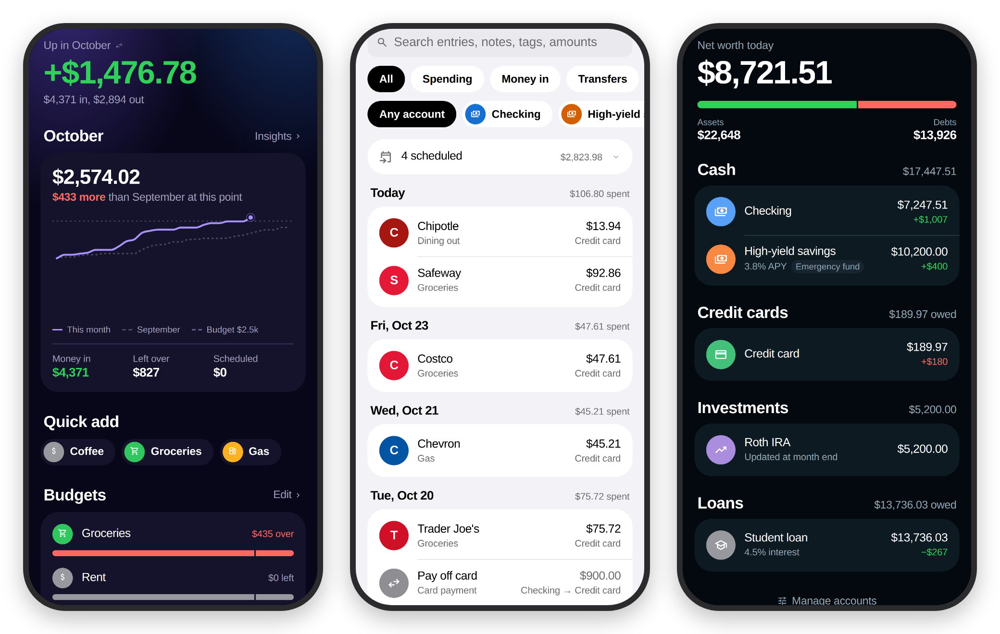
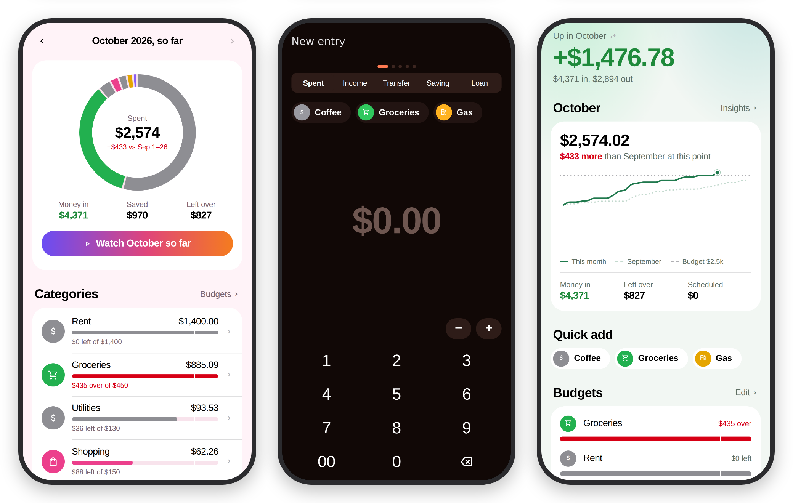
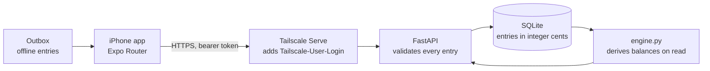

<p align="center">
  
</p>

<h1 align="center">Tally</h1>

<p align="center">A personal finance app for iPhone, backed by a small self-hosted server.</p>

<p align="center">
  
  
  
  
</p>

Tally is a ledger: every entry is one row with a date, a name, a category, an amount and a From and/or To account.
Account balances are never stored. They are derived from the entries every time they're read, so there is nothing to
drift out of sync. It replaced a spreadsheet and is in daily use.

The repo has two halves:

- `app/`, the backend: Python 3.13, FastAPI and SQLite. It holds the data and enforces every money rule.
- `ios/`, the iPhone app: Expo (React Native), SDK 57. It stores nothing of its own and talks to the backend over a
  private network (Tailscale).

<p align="center">
  
</p>

## Features

- Home shows the month's net change, spending drawn against last month's pace (drag across the chart to read any
  day), quick actions, budgets, goals, upcoming entries and recent activity.
- Activity lists every entry by day, with search shortcuts (`>50`, `aug`, `#trip`), filters, saved views, a
  long-press menu (edit, duplicate, delete with undo) and multi-select for recategorizing, tagging or deleting.
- Adding an entry uses a large keypad, merchant memory (a known name fills in its category and account), date
  shortcuts, refunds, splits, notes, tags and receipt photos.
- Catch up adds a backlog for one account at a time: it shows the account's newest entries as the place to resume,
  keeps the account and day from one entry to the next, flags a same-amount entry already in Tally, and shows the
  balance after each line to compare with the bank's running balance. Home points out an account not caught up for
  nine days.
- Entries made without a connection wait on the phone and send themselves later, exactly once.
- Entries can start from a link, `tally://new?amount=6.50&what=Starbucks&card=Amex`, so an iOS Shortcuts automation
  can open a prefilled entry after every tap to pay.
- Accounts shows assets against debts, a balance chart per account, and reconciliation against the bank with a
  diagnosis when the numbers don't match, or line by line against a statement CSV exported from the bank. Loans show
  a payoff date and what extra monthly payments would save.
- Deleted entries stay in Recently deleted for 30 days, after their Undo toast has gone.
- Insights has a month-by-month spending donut, budgets, cash flow, net worth, a month-end checklist and CSV export.
- Recurring entries (with suggestions from repeating ones, and skipping a single date), budgets suggested from past
  spending, goals, a configurable Home layout, eight color themes in light and dark, and the server's backup status
  in Settings.

<p align="center">
  
</p>

## Requirements

- A machine to run the backend: Python 3.13 and [uv](https://docs.astral.sh/uv/). SQLite is the only datastore.
- An iPhone with Expo Go, or a Mac with Xcode for a standalone build. There is no App Store or TestFlight build.
- A private network between the two. The setup below uses Tailscale.

## Install

There is no App Store, TestFlight or published build. The backend runs from a checkout, and the app runs in Expo Go
or as a standalone build made with Xcode; both are covered under Build from source and in
[docs/development.md](docs/development.md).

Without `TALLY_DB` the backend starts with an empty database, and `scripts/seed_demo.py` fills one with made-up data.
Without `TALLY_TOKEN` there is no login, which suits a local copy. Set `TALLY_TOKEN` to require
`Authorization: Bearer <token>` on every request, and `TALLY_OWNER` to also require the `Tailscale-User-Login` header
that Tailscale Serve adds to match that login. The app takes the token in Settings > Server and keeps it in the
keychain.

## How it works



### The ledger

The category type decides which accounts an entry needs, and the API rejects anything that breaks the rule:

| Category type | From | To |
|---|---|---|
| Money in | no | yes |
| Spending | yes | no |
| Transfer | yes | yes |
| Saving, Loan | yes | optional |

Balances are computed in `app/engine.py`, which has no database access and is tested on its own. Money is stored
as integer cents everywhere. Dollars only appear in request bodies and are converted once, on the way in.

When the spreadsheet was retired, `app/importer.py` imported it and checked that every account balance matched to
the cent.

### The app

The app is built with Expo Router, one file per screen. Pending entries live in a persisted outbox keyed by a
client-generated id, which the server treats as idempotent, so a retry after a dropped response never creates a
duplicate.

## Build from source

```sh
uv sync && uv run pytest                                            # backend tests
TALLY_DB=data/demo.db uv run uvicorn app.main:app --port 8000       # after: uv run python scripts/seed_demo.py data/demo.db
cd ios && npm install && npm test                                   # app tests
echo 'EXPO_PUBLIC_TALLY_URL=https://<tally-host>:8443' > .env.local # not committed
npx expo start
```

On a phone with Expo Go and Tailscale on, open `exp://<server's Tailscale IP>:8081` or scan the QR code. Every push to
`main` runs the same checks, plus ruff, the type check and lint, in GitHub Actions.

## Layout

| Path | Contents |
|---|---|
| `app/engine.py` | Balance calculations, with no database access |
| `app/db.py`, `app/migrate.py` | Schema, connections and migrations |
| `app/api*.py` | The JSON API |
| `app/recurring.py`, `app/search.py` | Recurring entries and search shortcuts (`>50`, `aug`, `#trip`) |
| `app/statement.py` | Reading bank statement CSVs and pairing their lines with entries |
| `app/importer.py` | Spreadsheet import |
| `app/main.py` | App setup and CSV export |
| `tests/` | Backend tests, each against a throwaway database |
| `scripts/` | Demo data and backups |
| `.github/workflows/` | The checks that run on every push |
| `ios/src/app` | Screens, one file per route |
| `ios/src/components` | Rolling digits, the scrub chart, rows, panels, the keypad |
| `ios/src/lib` | API client, outbox and the money rules the screens need |
| `ios/src/theme` | Colors, type, spacing and the eight themes |

Design notes are in `ios/DESIGN.md` and release notes in `CHANGELOG.md`.

## Known limitations

- One shared token, not user accounts. The backend is still meant for a private network only; don't expose it to the
  internet as is.
- Single user and single currency (USD).
- Apps signed with a free Apple ID expire after 7 days and have to be reinstalled from Xcode. A paid developer
  account would allow `eas build` and TestFlight instead.
- No bank sync. Entries are added by hand, by link or by Shortcuts automation, and balances are reconciled manually.

## License

MIT. See [LICENSE](LICENSE).
