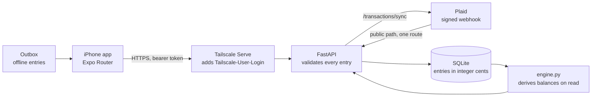

<p align="center">
  
</p>

<h1 align="center">Tally</h1>

<p align="center">A personal finance app for iPhone, backed by a small self-hosted server.</p>

<p align="center">
  
  
  
  
</p>

Tally is a ledger: every entry is one row with a date, a name, a category, an amount and a From and/or To account.
Account balances are never stored. They are derived from the entries every time they're read, so there is nothing to
drift out of sync. It replaced a spreadsheet and is in daily use.

The repo has two halves:

- `app/`, the backend: Python 3.13, FastAPI and SQLite. It holds the data and enforces every money rule.
- `ios/`, the iPhone app: Expo (React Native), SDK 57. It stores nothing of its own and talks to the backend over a
  private network (Tailscale).

## Features

- Bank sync through Plaid: connected accounts' transactions arrive minutes after Plaid has them (a signed webhook,
  with a check every four hours as a fallback). Rows Tally is sure of are added on their own, and each account is
  held at the bank's balance.
- First-time setup connects banks in one Plaid Link session, proposes an account for each bank account, and builds
  the ledger from up to two years of history with a starter set of categories.
- The check-in opens on its own the first time each day, or when new rows arrive. It lists what Tally wasn't sure
  of; a swipe right adds a row as guessed, a swipe left skips it, and a category menu changes it. New bank accounts
  are placed in one tap, and the week's automatic additions can be swiped away.
- Guesses come from history: the name and category of the same merchant's earlier entries, card payments paired
  across both accounts, then Plaid's own category mapped onto the ledger's.
- Summary shows the month's spending with two rings, spending against the budget (or last month) and how much of
  the month has gone, plus the week day by day and the latest entries.
- Activity groups entries by day, with search and a switcher for spending, income and transfers that swipes to
  either end.
- Accounts shows net worth over time (drag across the line to read a month) and cards and bank accounts stacked as
  cards in their banks' colors, or with a picture of the real card. A card zooms open into its account page.
- Entries show the merchant's or bank's logo (from Plaid, else logo.dev by website), and an entry's page is tinted
  with the brand's color.
- Adding by hand, for cash and money between people, uses a keypad, and entries made offline wait on the phone and
  send themselves later, exactly once.
- Face ID lock, a blurred app-switcher cover, and a choice of app icons.

## Requirements

- A machine to run the backend: Python 3.13 and [uv](https://docs.astral.sh/uv/). SQLite is the only datastore.
- An iPhone with Expo Go, or a Mac with Xcode for a standalone build. There is no App Store or TestFlight build.
- A private network between the two. The setup below uses Tailscale.
- For bank sync, Plaid API keys (`PLAID_CLIENT_ID`, `PLAID_SECRET`, `PLAID_ENV`), and for the webhook a public HTTPS
  path to `/api/bank/webhook/<secret>` (`PLAID_WEBHOOK_URL`). Without the keys the bank routes answer 404 and entries
  are added by hand. `LOGO_DEV_KEY` (a logo.dev publishable key) adds logos for names Plaid doesn't know.

## Install

There is no App Store, TestFlight or published build. The backend runs from a checkout, and the app runs in Expo Go
or as a standalone build made with Xcode; both are covered under Build from source and in
[docs/development.md](docs/development.md).

Without `TALLY_DB` the backend starts with an empty database, and `scripts/seed_demo.py` fills one with made-up data.
Without `TALLY_TOKEN` there is no login, which suits a local copy. Set `TALLY_TOKEN` to require
`Authorization: Bearer <token>` on every request, and `TALLY_OWNER` to also require the `Tailscale-User-Login` header
that Tailscale Serve adds to match that login. The app takes the token in Settings > Server and keeps it in the
keychain.

## How it works



### The ledger

The category type decides which accounts an entry needs, and the API rejects anything that breaks the rule:

| Category type | From | To |
|---|---|---|
| Money in | no | yes |
| Spending | yes | no |
| Transfer | yes | yes |
| Saving, Loan | yes | optional |

Balances are computed in `app/engine.py`, which has no database access and is tested on its own. Money is stored
as integer cents everywhere. Dollars only appear in request bodies and are converted once, on the way in.

When the spreadsheet was retired, `app/importer.py` imported it and checked that every account balance matched to
the cent.

### Bank sync

Bank rows live in their own database (`bank.db`, which holds the access tokens), never in the ledger. A row points
at the entry it became, and every sync re-checks those pointers, so the ledger can be replaced without the two
drifting apart. The webhook route skips the API login and proves itself instead: the URL carries a secret, and each
message must carry Plaid's ES256 signature over its exact body, under five minutes old.

### The app

The app is built with Expo Router, one file per screen. Pending entries live in a persisted outbox keyed by a
client-generated id, which the server treats as idempotent, so a retry after a dropped response never creates a
duplicate.

## Build from source

```sh
uv sync && uv run pytest                                            # backend tests
TALLY_DB=data/demo.db uv run uvicorn app.main:app --port 8000       # after: uv run python scripts/seed_demo.py data/demo.db
cd ios && npm install && npm test                                   # app tests
echo 'EXPO_PUBLIC_TALLY_URL=https://<tally-host>:8443' > .env.local # not committed
npx expo start
```

On a phone with Expo Go and Tailscale on, open `exp://<server's Tailscale IP>:8081` or scan the QR code. Every push to
`main` runs the same checks, plus ruff, the type check and lint, in GitHub Actions.

## Layout

| Path | Contents |
|---|---|
| `app/engine.py` | Balance calculations, with no database access |
| `app/db.py`, `app/migrate.py` | Schema, connections and migrations |
| `app/api*.py` | The JSON API |
| `app/recurring.py`, `app/search.py` | Recurring entries and search shortcuts (`>50`, `aug`, `#trip`) |
| `app/statement.py` | Reading bank statement CSVs and pairing their lines with entries |
| `app/importer.py` | Spreadsheet import |
| `app/bank.py`, `app/plaid.py`, `app/api_bank.py` | Bank sync: Plaid client, webhook, guesses, automatic adds |
| `app/api_setup.py` | First-time setup from connected banks |
| `app/logos.py`, `app/api_logos.py` | Logos, brand colors and card faces |
| `app/main.py` | App setup and CSV export |
| `tests/` | Backend tests, each against a throwaway database |
| `scripts/` | Demo data and backups |
| `.github/workflows/` | The checks that run on every push |
| `ios/src/app` | Screens, one file per route |
| `ios/src/design` | System colors, type, motion and haptics, and the shared views (rows, cards, rings, keypad) |
| `ios/src/lib` | API client, outbox, bank check-in timing and lock |

Design notes are in `ios/DESIGN.md`, development notes in `docs/development.md` and release notes in `CHANGELOG.md`.

## Known limitations

- One shared token, not user accounts. The backend is still meant for a private network only; don't expose it to the
  internet as is.
- Single user and single currency (USD).
- Apps signed with a free Apple ID expire after 7 days and have to be reinstalled from Xcode. A paid developer
  account would allow `eas build` and TestFlight instead.
- Plaid's Trial plan allows ten connections in total, ever; a repaired connection keeps its slot, a removed one
  doesn't come back.
- Plaid checks most banks one to four times a day, so a purchase can take hours to appear even with the webhook.
- Investment and loan accounts take their balances from the bank but not their transactions.

## License

MIT. See [LICENSE](LICENSE).
